<!-- ================================================================== -->
<!--   anilcodematrix | Profile README v2                               -->
<!--   Stats, streak, languages, activity and project cards are         -->
<!--   self-hosted: built by .github/workflows/profile-cards.yml and    -->
<!--   published to the "output" branch twice a day.                    -->
<!-- ================================================================== -->

<div align="center">

<a href="https://anilkumarsutiharsharma.com.np">

</a>


<br/>

<a href="https://anilkumarsutiharsharma.com.np"></a>
<a href="https://anilcodematrix.github.io"></a>
<a href="mailto:anil.codematrix@gmail.com"></a>

<br/>


</div>

<br/>

<!-- ============================ ABOUT ============================ -->

<table width="100%">
<tr>
<td width="58%" valign="top">

### 👨‍💻 About me

I'm **Anil**, a full-stack developer and AI engineer from Nepal. I build web apps end to end, from the database to the UI, and I like adding AI where it saves people real time.

- 🚀 **Building:** full-stack, AI-powered SaaS products
- 🧠 **Learning:** MLOps, deep learning and RAG
- 🤖 **Automating:** my own [daily AI agent](https://github.com/anilcodematrix/anil-sharma-daily) runs on GitHub Actions every day
- 🤝 **Open to:** freelance work and open-source collaboration
- 🌐 **Portfolio:** [anilkumarsutiharsharma.com.np](https://anilkumarsutiharsharma.com.np)
- 📫 **Reach me:** [anil.codematrix@gmail.com](mailto:anil.codematrix@gmail.com)

</td>
<td width="42%" valign="top">

```typescript
const anil = {
  name:     "Anil Kumar Sutihar Sharma",
  role:     "Full-Stack Dev & AI Engineer",
  location: "Nepal (UTC+5:45)",
  website:  "anilkumarsutiharsharma.com.np",
  focus:    ["AI SaaS", "RAG", "MLOps"],
  status:   "Open to collaborate & freelance",
};
```

</td>
</tr>
</table>

<!-- ========================== TECH STACK ========================== -->

<h2 align="center">🛠️ Tech Stack</h2>

<div align="center">

| Area | Tools |
|:--:|:--|
| **Frontend** |  |
| **Backend** |  |
| **AI / ML** |  |
| **Databases** |  |
| **DevOps & Cloud** |  |

</div>

<!-- ========================== ANALYTICS =========================== -->

<h2 align="center">📊 GitHub Analytics</h2>

<div align="center">







<sub>Cards are generated by my own GitHub Action and refresh twice a day.</sub>

</div>

<!-- =========================== PROJECTS =========================== -->

<h2 align="center">🚀 Featured Projects</h2>

<div align="center">

<a href="https://github.com/anilcodematrix/Full-Stack-Development-Assignment"></a>
<a href="https://github.com/anilcodematrix/Concept-of-AI-and-Technologies"></a>
<a href="https://github.com/anilcodematrix/anil-sharma-daily"></a>
<a href="https://anilcodematrix.github.io"></a>

| Project | What it does | Stack | Status |
|:--|:--|:--:|:--:|
| &nbsp;[Portfolio website](https://anilkumarsutiharsharma.com.np) | My personal site, projects and contact | Web |  |
| &nbsp;[Anil Sharma AI](https://anilcodematrix.github.io) | AI assistant that answers anything, free with no API key | HTML · JS · LLM |  |
| &nbsp;[Daily AI Agent](https://github.com/anilcodematrix/anil-sharma-daily) | Agent that commits a daily log with quotes and tech tips | Python · GitHub API · Cron |  |
| &nbsp;[Full-Stack Dev](https://github.com/anilcodematrix/Full-Stack-Development-Assignment) | Full-stack web apps with CRUD and MySQL | HTML · CSS · JS · PHP |  |
| &nbsp;[AI Concepts](https://github.com/anilcodematrix/Concept-of-AI-and-Technologies) | Notebooks on classification, regression and deep learning | Python · Jupyter · TensorFlow |  |

</div>

<!-- ============================ ANILBOT =========================== -->

<h2 align="center">💬 Chat with Anil Sharma AI</h2>

<div align="center">

<a href="https://anilcodematrix.github.io">

</a>

<sub><i>Try:</i> "What is his tech stack?" · "Is he available to hire?" · "Explain RAG simply" · "Help me debug my Python code"</sub>

</div>

<!-- ============================ SNAKE ============================= -->

<h2 align="center">🐍 Contribution Snake</h2>

<div align="center">


</div>

<!-- =========================== CONNECT ============================ -->

<h2 align="center">🤝 Connect with Me</h2>

<div align="center">

<a href="https://anilkumarsutiharsharma.com.np"></a>
<a href="mailto:anil.codematrix@gmail.com"></a>
<a href="https://linkedin.com/in/anil-kumar-sutihar-sharma-275122316"></a>
<a href="https://instagram.com/anilsharma.io_10"></a>
<a href="https://facebook.com/anil.sharma.440897"></a>

<br/><br/>


</div>
